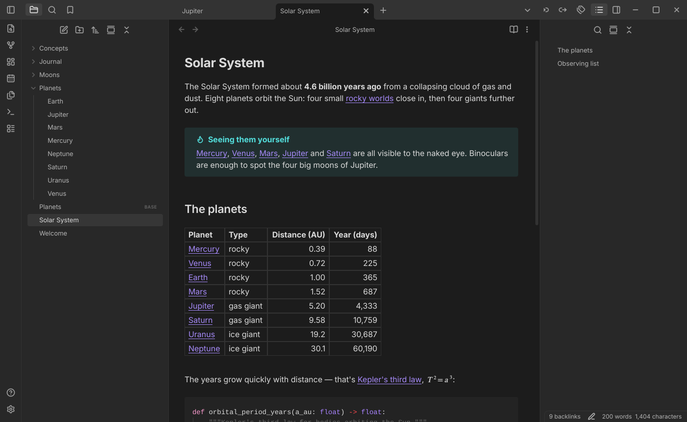
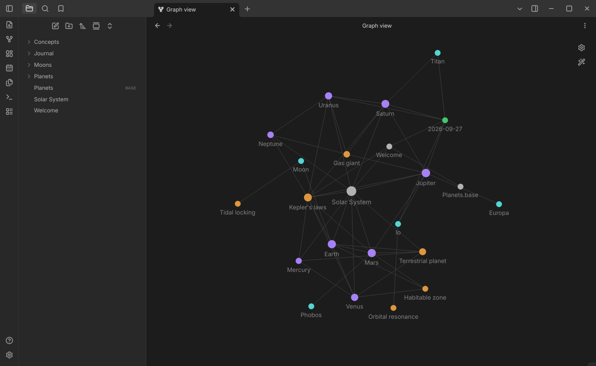
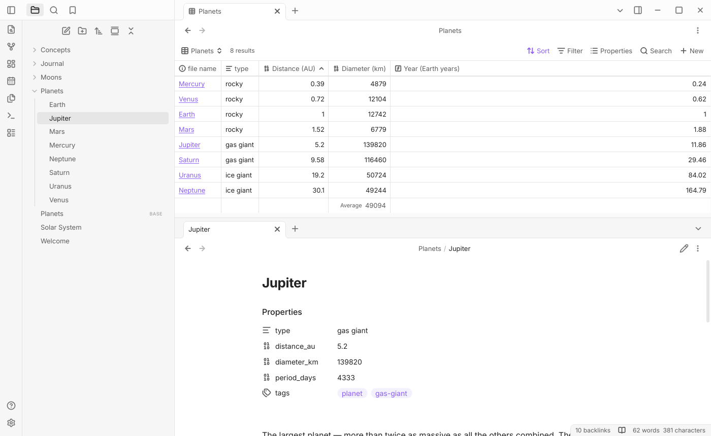

# obsidian-cpp

A native C++23 / Qt 6 clone of [Obsidian](https://obsidian.md), the Markdown knowledge base. It opens a folder of
notes (a *vault*) and mirrors Obsidian 1.13's look and behaviour, without using any of its code.



| Graph view | Bases (light theme) |
|---|---|
|  |  |

## Features

- **Editor**: Live Preview, Source and Reading views; tables, callouts, math, highlighted code, embeds, footnotes,
  properties, folding, multiple cursors, Vim mode and spellcheck.
- **Links**: wikilinks and Markdown links, backlinks and outgoing links, hover previews, autocomplete, and links that
  update when you rename a note.
- **Workspace**: tabs, splits, stacked tabs, pop-out windows, quick switcher, command palette, search and hotkeys.
- **More views**: graph and local graph, Canvas, Bases, and PDF, image, audio and video viewers.
- **Core plugins**: daily notes, templates, bookmarks, note composer, file recovery, PDF export, word count and more.
- **Big vaults**: parsing is incremental, and a 5.5 MB note opens in under 250 ms.

Your Obsidian setup is never touched: the clone keeps its own settings in `~/.config/obsidian-cpp` and never reads or
writes `<vault>/.obsidian/`. Browsing a vault changes no files. [docs/PARITY.md](docs/PARITY.md) lists what is
implemented and the known differences.

## Build and run (Arch Linux)

```sh
sudo pacman -S --needed base-devel cmake ninja qt6-base qt6-svg qt6-multimedia qt6-webengine \
    syntax-highlighting sonnet kio yaml-cpp zstd sqlite xxhash gtest hunspell-en_us

cmake --preset rel && cmake --build --preset rel
build/rel/obsidian-cpp            # vault picker
build/rel/obsidian-cpp ~/notes    # open a folder as a vault
cmake --install build/rel --prefix ~/.local   # optional: binary, icon and .desktop entry
```

Tests: `cmake --preset dev && cmake --build --preset dev && ctest --preset dev` (Debug with ASan/UBSan).
See [CLAUDE.md](CLAUDE.md) and [docs/](docs/) for development notes and the architecture.

---

An unofficial project, not affiliated with or endorsed by Obsidian. Icons are from [Lucide](https://lucide.dev) (ISC);
math rendering uses [JKQtMathText](https://github.com/jkriege2/JKQtPlotter) (LGPL-2.1).
